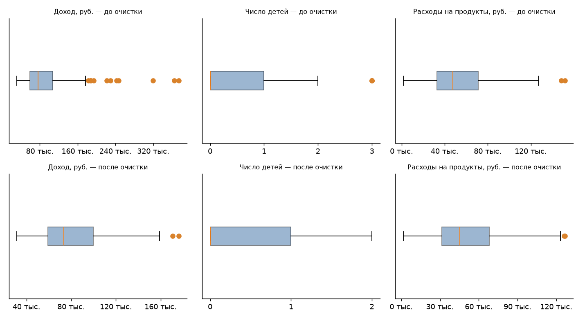
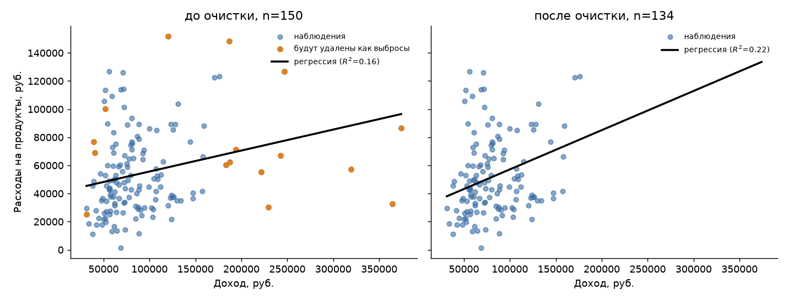
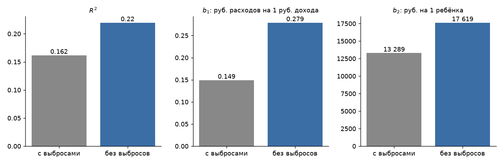
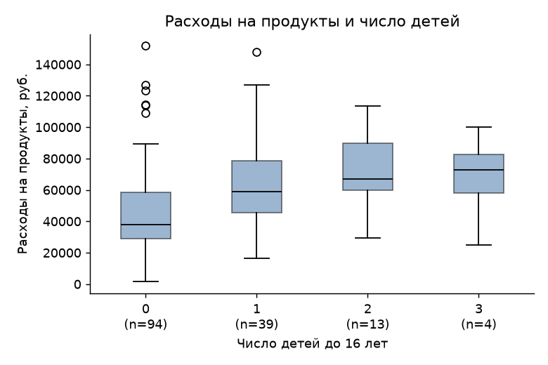

# ДЗ 2. Значимость уравнения регрессии и его параметров

**Регион:** 04 (`TER = 4`). **Что объясняем ($y$):** расходы домохозяйства на продукты, `PROD`. **Чем объясняем:** среднедушевой денежный доход `DOXODN` ($x_1$) и число детей до 16 лет `CHDET` ($x_2$). **Уровень значимости:** $\alpha = 0{,}05$.

Файлы рядом с отчётом: `расчёт_дз2.py` (весь расчёт), `результаты_расчёта.txt` (полный вывод), `выборка_ter04_150.csv` (150 наблюдений), `README.md` (как вручную считать ошибки модели).

---

## 1. Что требовалось сделать (простыми словами)

Нужно проверить, **от чего зависят траты семьи на продукты**, с помощью линейной регрессии:

$$PROD = b_0 + b_1 \cdot DOXODN + b_2 \cdot CHDET .$$

Смысл коэффициентов:
- $b_1$ — на сколько рублей в среднем растут расходы на продукты, если доход вырос на 1 рубль (число детей то же);
- $b_2$ — на сколько рублей в среднем больше тратит семья, если у неё на одного ребёнка больше (доход тот же);
- $b_0$ — «условное начало», расходы при нулевом доходе и без детей (чисто математическая величина).

Задание по шагам:
1. Взять один регион и 150 домохозяйств; нули в $y$ заменить единицами.
2. **F-тест:** есть ли в модели хоть что-то полезное? ($H_0$: все коэффициенты равны 0, то есть доход и дети на расходы не влияют.)
3. **t-тесты:** влияет ли *каждый* показатель по отдельности (и значим ли свободный член)?
4. **$R^2$:** какую долю разброса расходов объясняет модель.
5. Найти **выбросы** — необычно большие или малые значения — по методу «ящик с усами», удалить их, повторить пп. 2–4 и сравнить.
6. Сделать выводы про взаимодействие показателей в регионе.

Правило проверки гипотез одно: если $p < 0{,}05$, то $H_0$ отвергаем (эффект есть). Если $p \ge 0{,}05$, оснований считать, что эффект есть, нет.

---

## 2. Данные

В файле микроданных по региону 04 найдено 3323 домохозяйства. Случайно (`random_state = 2026`) отобрано 150. Нулевых расходов на продукты в выборке нет, замена нулей на единицы никого не затронула.

| показатель | среднее | медиана | минимум | максимум |
|---|---|---|---|---|
| Доход (`DOXODN`), руб. | 93 139 | 76 150 | 31 427 | 373 942 |
| Число детей (`CHDET`) | 0,51 | 0 | 0 | 3 |
| Расходы на продукты (`PROD`), руб. | 54 617 | 47 804 | 1 551 | 151 827 |

Среднее выше медианы и по доходу, и по расходам. Это признак выбросов справа: несколько очень богатых семей «тянут» среднее вверх. В выборке 94 семьи без детей, 39 с одним ребёнком, 13 с двумя и 4 с тремя.

Корреляции пар: расходы–доход 0,22; расходы–дети 0,29; доход–дети −0,17. Последняя отрицательная, потому что доход считается на человека: чем больше в семье детей, тем меньше доход на каждого.

---

## 3. Выбросы: как их нашли

Метод «ящика с усами»: $Q_1$ и $Q_3$ — нижняя и верхняя четверти данных, $IQR = Q_3 - Q_1$. Значение считается выбросом, если оно лежит за пределами $[Q_1 - 1{,}5\,IQR;\ Q_3 + 1{,}5\,IQR]$. Проверялись все три показателя, строка удалялась, если выброс найден хотя бы в одном.

| показатель | допустимый диапазон | выбросов |
|---|---|---|
| Доход | от −13 578 до 180 120 | 11 |
| Число детей | от −1,5 до 2,5 | 4 (семьи с тремя детьми) |
| Расходы на продукты | от −24 869 до 129 006 | 2 |

Удалено 16 строк (некоторые строки были выбросами сразу по двум показателям), осталось **134**.



*Как читать:* ящик — «средние» 50 % значений, оранжевая черта — медиана, оранжевые точки — выбросы. Сверху — до очистки (доход имеет длинный хвост до 370 тыс.), снизу — после.

Две оговорки:
- Число детей — целое и принимает значения 0–3, поэтому «выбросом» формально стали семьи с тремя детьми. Это не ошибка данных, а следствие правила. Решение удалить их принято по заданию (очищать *все* исходные $x$ и $y$).
- После удаления на ящиках снова появляются отдельные точки: границы пересчитались на более узкой выборке. Это нормально для метода, повторно чистить не требуется.

---

## 4. Результаты регрессии

### До очистки (150 наблюдений)

$$\widehat{PROD} = 33\,904 + 0{,}149 \cdot DOXODN + 13\,289 \cdot CHDET$$

| параметр | значение | станд. ошибка | $t$ | $p$ | вывод |
|---|---|---|---|---|---|
| $b_0$ | 33 904 | 4 877 | 6,95 | < 0,001 | значим |
| $b_1$ (доход) | 0,149 | 0,041 | 3,67 | 0,0003 | значим |
| $b_2$ (дети) | 13 289 | 3 000 | 4,43 | < 0,001 | значим |

- **F-тест:** $F = 14{,}18$ при критическом $3{,}06$, $p < 0{,}001$. $H_0$ отвергаем: модель в целом значима.
- **$R^2 = 0{,}162$**, скорректированный $R^2_{adj} = 0{,}150$.
- Критическое значение $t$ равно 1,98, все $|t|$ его превышают.

### После очистки (134 наблюдения)

$$\widehat{PROD} = 21\,364 + 0{,}279 \cdot DOXODN + 17\,619 \cdot CHDET$$

| параметр | значение | станд. ошибка | $t$ | $p$ | вывод |
|---|---|---|---|---|---|
| $b_0$ | 21 364 | 6 602 | 3,24 | 0,0015 | значим |
| $b_1$ (доход) | 0,279 | 0,071 | 3,93 | 0,0001 | значим |
| $b_2$ (дети) | 17 619 | 3 341 | 5,27 | < 0,001 | значим |

- **F-тест:** $F = 18{,}44$ при критическом $3{,}07$, $p < 0{,}001$: модель значима.
- **$R^2 = 0{,}220$**, $R^2_{adj} = 0{,}208$.



*Как читать:* каждая точка — домохозяйство. Оранжевые — будущие выбросы. Чёрная линия — зависимость расходов от дохода при среднем числе детей. После очистки линия идёт круче, потому что богатые семьи с небольшими расходами (оранжевые точки справа внизу) перестали её «прижимать».



---

## 5. Выводы

**Что изменилось после очистки.**
- Значимость не пропала, а усилилась: $F$ вырос с 14,2 до 18,4, все $p$ остались меньше 0,05.
- Коэффициент при доходе почти удвоился (0,149 → 0,279). Выбросы по доходу ослабляли связь: у части очень богатых семей расходы на продукты не выросли.
- Коэффициент при детях вырос с 13,3 до 17,6 тыс. руб.
- Объясняющая сила выросла с 16 % до 22 %.

**Что значат коэффициенты (после очистки).**
- При росте среднедушевого дохода на 1 000 руб. расходы на продукты в среднем растут примерно на 279 руб. (при том же числе детей). Из каждого дополнительного рубля дохода около 28 копеек уходит на продукты.
- Каждый ребёнок до 16 лет добавляет в среднем около 17,6 тыс. руб. расходов на продукты при том же среднедушевом доходе.
- Свободный член значим, но смысла «расходы при нулевом доходе» не имеет: он просто сдвигает линию.

**Насколько модель хороша.** Значимость не равна качеству. Модель «работает» (связь не случайна), но объясняет лишь 16–22 % разброса расходов. Остальное зависит от факторов вне модели: размера семьи, цен, привычек, питания вне дома. Поэтому точный прогноз по ней для отдельной семьи невозможен.

**Про предположение задания.**



Предполагалось, что число детей не влияет на расходы на продукты. Данные это опровергли: $p < 0{,}001$ и до, и после очистки. Это логично: чем больше детей, тем больше еды. Медианные расходы растут с числом детей: 37,8 тыс. руб. (0 детей), 59,1 тыс. (1), 67,2 тыс. (2). У семей с тремя детьми (всего 4 семьи) медиана 72,9 тыс. По заданию один из двух $x$ должен быть незначим, поэтому для строгого выполнения задания нужно взять другой показатель вместо `CHDET`. Здесь `CHDET` оставлен, и результат честно показан как есть.

**Взаимодействие показателей в регионе.** Расходы растут и с доходом, и с числом детей, но слабо связаны с ними (корреляции 0,22 и 0,29). Доход и число детей связаны отрицательно (−0,17): в многодетных семьях доход на человека ниже. Возможно, поэтому доход и дети частично «перебивают» друг друга; это предположение, отдельной проверки (например, регрессии только на доход) в работе нет.

---

## 6. Как воспроизвести

```bash
.venv/bin/python "ДЗ/ДЗ_2/расчёт_дз2.py"
```

Скрипт отбирает 150 домохозяйств региона 04, считает регрессию, $F$- и $t$-тесты вручную (через матрицы), сверяет с `statsmodels` и строит графики. Ручной расчёт ошибок модели описан в `README.md`.
